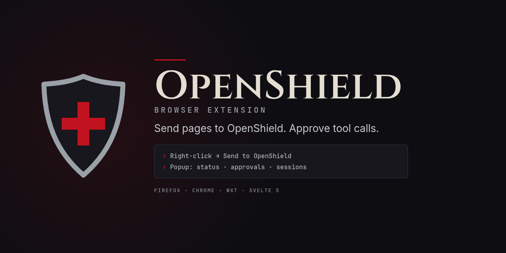

<p align="center">
  
</p>

<h1 align="center">OpenShield browser extension</h1>

<p align="center">Send pages and selections into an OpenShield session, watch status and approve tool calls from Firefox or Chrome.</p>

<p align="center">
  <a href="https://github.com/Blackshield-Company/openshield-extension/actions/workflows/ci.yml"></a>
  <a href="LICENSE"></a>
  <a href="https://github.com/Blackshield-Company/openshield"></a>
</p>

A Firefox and Chrome remote for a running [OpenShield](https://github.com/Blackshield-Company/openshield) instance (`openshield serve`). It does no work on its own: it talks to your OpenShield server over its REST + WebSocket API.

- **Send to OpenShield**: right-click a selection or a page, then choose the current session or a new one. GitHub issue and PR pages are detected and tagged.
- **Popup**: connection state, pending approvals, recent sessions (pick the current one) and the last messages of the current session.
- **Approvals**: pending tool calls raise a notification. On Chrome you can approve or deny from the notification; on Firefox, click it to open the approval window. The popup always has Approve and Deny.
- **Settings**: host, port and pairing token.

Status: early MVP (0.1.0). Not published to any store yet; load it unpacked.

## Requirements

- `openshield serve` **1.1.1 or newer** (token required on every request).
- Node 20+ to build.

## Build and load

```sh
npm ci
npm run build           # Chrome MV3  -> .output/chrome-mv3
npm run build:firefox   # Firefox MV2 -> .output/firefox-mv2
npm run lint:firefox    # web-ext lint
npm test
```

- **Chrome**: `chrome://extensions`, enable Developer mode, *Load unpacked*, pick `.output/chrome-mv3`.
- **Firefox**: `about:debugging#/runtime/this-firefox`, *Load Temporary Add-on*, pick `.output/firefox-mv2/manifest.json`.

`npm run dev` / `npm run dev:firefox` start a live-reloading browser.

## Pairing

1. Start the server: `openshield serve` (binds `127.0.0.1:9310` by default).
2. Open the extension settings and enter host, port and the token from `~/.config/openshield/desktop.token` (or a pairing token minted by `POST /api/v1/pair`).
3. The settings page shows the extension's origin (`chrome-extension://…` or `moz-extension://…`). Add it to the server's CORS allowlist:

   ```toml
   # ~/.config/openshield/config.toml
   [desktop]
   allowed_origins = ["chrome-extension://<your-extension-id>"]
   ```

## Security

- The token is sent as `Authorization: Bearer` on every HTTP request and as `?token=` on the WebSocket, and is stored in `storage.local` only (never synced).
- Only loopback and private LAN hosts are accepted. Loopback is granted at install; a LAN host triggers an explicit host-permission prompt. Never expose port 9310 to the internet.
- Page content can contain hostile instructions. Everything sent from a page is wrapped in an `<untrusted>` block with a notice telling the agent to treat it as data, and attempts by the page to close that block are stripped. Pages are capped at 20,000 characters.
- Approval decisions go to `POST /api/v1/approvals/:id`. The server denies a request after 120 s with no answer.

## How it works

The background worker keeps the `/ws/v1/chat` socket open (pinging every 20 s so the MV3 worker stays awake), reconnects with backoff, and a 1-minute alarm re-checks health and polls `/api/v1/approvals` after the worker sleeps. Note that OpenShield only holds tool calls for approval while a chat client is connected.

Built with [WXT](https://wxt.dev), Svelte 5 and TypeScript. The client in `src/lib/client.ts` is ported from OpenShield Desktop.

## License

Apache-2.0. See [LICENSE](LICENSE).
